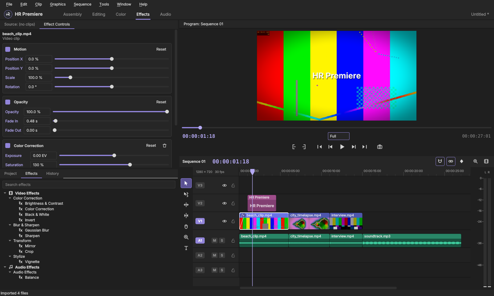
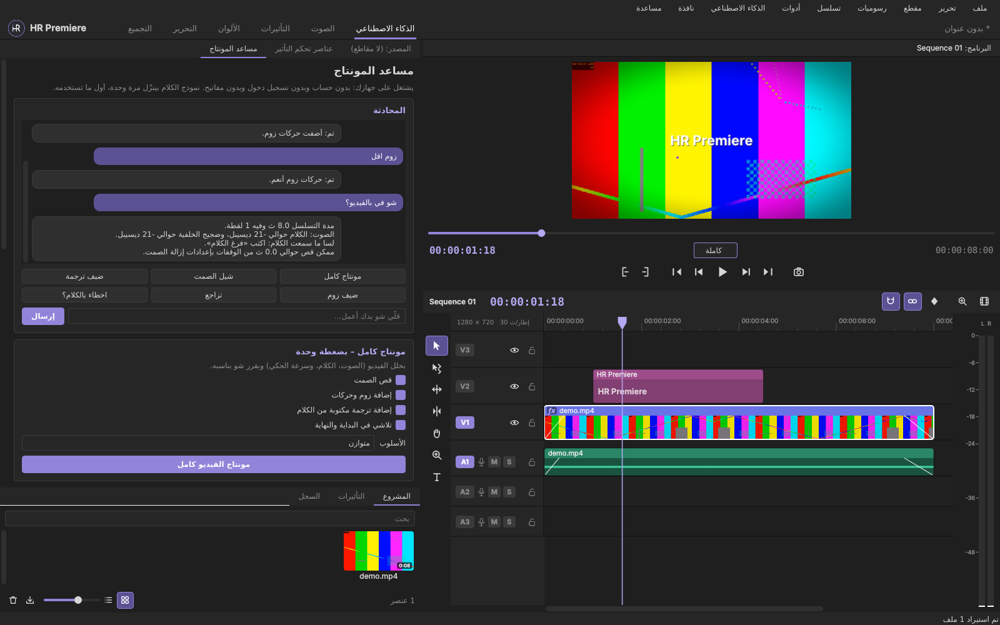
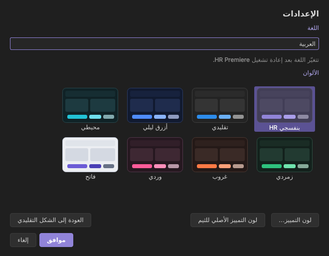
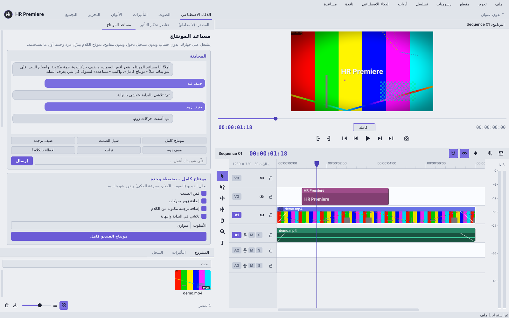

<p align="center">
  
</p>

<h1 align="center">HR Premiere</h1>

<p align="center">محرر فيديو لسطح المكتب مكتوب بلغة <b>C++</b> باستخدام <b>Qt 6</b> و<b>FFmpeg</b>، بنفس فكرة وتصميم Adobe Premiere Pro.</p>


## المميزات (الإصدار 0.1)

| | |
|---|---|
| **الواجهة** | نفس تقسيم بريمير: Source و Program و Project و Effect Controls و Effects و History و Timeline، مع شريط مساحات العمل (Assembly / Editing / Color / Effects / Audio) والألواح قابلة للسحب والتجميع. |
| **التايم لاين** | عدة مسارات فيديو وصوت، صور مصغّرة وموجات صوت على المقاطع، مسطرة Timecode، قفل/إخفاء/كتم/Solo للمسارات، تكبير وتصغير، Snap مغناطيسي. |
| **الأدوات** | Selection (V) · Track Select Forward (A) · Ripple Edit (B) · Razor (C) · Hand (H) · Zoom (Z) · Type (T). |
| **التحرير** | سحب وإفلات من لوحة المشروع، نقل المقاطع بين المسارات، تقليم الحواف، قص (Ctrl+K)، حذف عادي وحذف متتابع (Ripple)، نسخ/لصق، ربط الصوت بالصورة (Linked)، علامات (Markers) ونقطتي In/Out، Insert/Overwrite من Source، تراجع وإعادة غير محدودين تقريباً مع لوحة History. |
| **السرعة والمدة** | `Clip ▸ Speed / Duration` (`Ctrl+R`): حركة بطيئة أو سريعة من 5% إلى 2000% للصورة والصوت معاً (الصوت يتبع السرعة مثل مشغّل الشريط)، أو اكتب المدة المطلوبة والسرعة تنضبط لحالها. خيار Ripple يسحب المقاطع اللي بعدها. |
| **التأثيرات** | Motion (موقع/حجم/دوران) · Opacity مع Fade In/Out · Volume مع Fade · Balance · Brightness & Contrast · Color Correction · Black & White · Invert · Gaussian Blur · Sharpen · Mirror · Crop · Vignette · العناوين (Titles) بخط ولون وظل. |
| **التصدير** | H.264 · H.265 · ProRes · VP9 · GIF · MP3 · WAV بنفس محرك المعاينة (ما تشوفه هو ما يُصدَّر). |
| **المشاريع** | حفظ وفتح ملفات `.hrproj`، وإعادة ربط الملفات تلقائياً إذا نُقل المشروع. |
| **تسجيل الصوت (مايك)** | زر المايك في ترويسة كل مسار صوتي: عدّاد 3-2-1 ثم تسجيل فوق الفيديو، ويُضاف التسجيل تلقائياً على المسار عند المؤشر. `Space` يوقف التسجيل. |
| **الذكاء الاصطناعي** | لوحة **مساعد المونتاج** تشتغل على جهازك بدون حساب ولا مفاتيح: **مونتاج كامل بضغطة** (يقص الصمت ويضيف حركات زوم وتلاشي وترجمة حسب نوع الفيديو)، **محادثة بالعربي أو الإنجليزي** لتعديل اللي عمله، فهم الكلام وكتابته مع تنظيف الصوت الضعيف وعلامة ⚠ على الجمل المشكوك فيها، وتعديل النص بنفسك. التفاصيل بالأسفل. |
| **اللغة والألوان** | البرنامج كامل **بالعربية (واجهة من اليمين لليسار) أو بالإنجليزية**، تختارها عند التثبيت أو أول تشغيل وتغيّرها من *Edit ▸ Preferences*. ثمانية ثيمات ألوان (البنفسجي الافتراضي، التقليدي الرمادي، أزرق ليلي، محيطي، زمردي، غروب، وردي، فاتح) مع لون تمييز تختاره، وتتبدّل فوراً بدون إعادة تشغيل. |
| **الملكية** | صفحة «الملكية» (من قائمة Help أو بالضغط على لوقو HR أعلى البرنامج). |
| **الأداء** | معاينة 1080p بـ ~3 ms للإطار، وتصدير أسرع من الزمن الحقيقي. فك الترميز والتركيب على خيط منفصل فالواجهة ما تتجمد. |



## التحميل (ويندوز)

كل مرة يُرفع تعديل على المشروع، يبني **GitHub Actions** البرنامج ويختبره ويجهّز نسخة ويندوز:

* **`HR-Premiere-Setup`** – برنامج تثبيت (`HR-Premiere-Setup.exe`): أول صفحة فيه تختار **العربية أو English**، وبعدها يشتغل البرنامج بنفس اللغة ولا يسألك مرة ثانية
* **`HR-Premiere-portable`** – نسخة محمولة: فك الضغط ثم شغّل `HRPremiere.exe` (أول تشغيل يسألك عن اللغة)

من تبويب **Actions** في GitHub ← آخر تشغيل لـ *Build HR Premiere* ← قسم **Artifacts** في أسفل الصفحة.
(عند الدمج في الفرع الرئيسي تُنشر النسخة تلقائياً أيضاً في **Releases** باسم `hr-premiere-latest` كملفين جاهزين للتحميل المباشر.)

يتحقق الـCI على ويندوز من: البناء، كل الاختبارات، وتشغيل الحزمة على مسار نظيف (بدون أي برامج مثبّتة) مع تصدير تجريبي بالـ`ffmpeg.exe` المرفق.

> `ffmpeg.exe` مرفق داخل الحزمة ويُستخدم للتصدير. تفاصيل التراخيص في `NOTICE.txt` داخل الحزمة.

## البدء السريع

1. **File ▸ Import** (`Ctrl+I`) أو اسحب ملفات الفيديو/الصوت/الصور إلى لوحة **Project**.
2. اسحب مقطعاً إلى **Timeline**. أول مقطع يضبط إعدادات الـ Sequence (الأبعاد والـ fps) تلقائياً.
3. قصّ بـ `Ctrl+K` أو بأداة الشفرة `C`، رتّب المقاطع، وقلّم الحواف بالسحب.
4. اضغط على مقطع ثم عدّل **Effect Controls**، أو اسحب تأثيراً من لوحة **Effects** فوق المقطع.
5. `T` ثم اضغط على مسار فيديو لإضافة عنوان، وعدّل النص من Effect Controls.
6. **File ▸ Export Media** (`Ctrl+M`).

## الذكاء الاصطناعي (مساعد المونتاج)

كل شيء يشتغل **على جهازك**: بدون تسجيل دخول، بدون حساب، بدون مفاتيح API. افتح تبويب **AI** (أعلى البرنامج) أو قائمة **AI**. اللوحة بالعربي أو الإنجليزي حسب لغة البرنامج.



### مونتاج كامل بضغطة

زر **«مونتاج الفيديو كامل»** (أو اكتب في المحادثة «مونتاج كامل»): البرنامج يحلل الفيديو (مستوى الصوت، الكلام، سرعة الحكي، شكل الصورة) ويقرر بنفسه:

* **يقص الصمت**، لكن فقط الفراغات اللي فعلاً هادئة؛ اللي فيها صوت بدون كلمات معروفة (موسيقى أو ضجيج) يتركها.
* **يقسم اللقطات الطويلة** عند الجمل ويضيف **حركات زوم**: كل لقطة ثانية أقرب (Punch-in)، وكل لقطة تقرّب ببطء أثناء العرض، وبالأسلوب الهادئ تتنفّس (تقرّب ثم تبعد). الحركة معلمات عادية (Zoom / Pan X / Pan Y) في Effect Controls فتقدر تعدّلها أو تضيفها بإيدك.
* **يضيف ترجمة مكتوبة** من الكلام (أقصر وأصغر إذا الفيديو عمودي).
* **تلاشي** بالبداية والنهاية.
* الأسلوب يتبدّل: متوازن، **سريع** (تيك توك/ريلز: قص أقرب وحركات أسرع)، أو **هادئ** (سينمائي). وإذا المتحدث بيحكي بسرعة يقص حتى الوقفات القصيرة، وإذا ببطء يقص الطويلة بس.
* بعد التنفيذ **يشرح لك شو عمل ولماذا** («قصيت 12 وقفة… السبب: المتحدث بيحكي ببطء…»). وكل شيء **تراجع واحد** (`Ctrl+Z`).

### محادثة تعدّل بها اللي عمله

اكتب بكلامك العادي، بالعربي أو الإنجليزي (أو اضغط الأزرار السريعة):

| تقول | يصير |
|---|---|
| «زوم اقل» · «زوم اكثر» · «بدون زوم» · «ضيف فيد» | يعيد المونتاج بالتعديل المطلوب من نفس الأصل (بدون ما يتراكم تعديل فوق تعديل). |
| «شيل الصمت اللي اطول من ثانية» | يقص الوقفات الأطول من المدة المحددة. |
| «ضيف ترجمة» · «شيل الترجمة» · «خلي الترجمة صفراء / أكبر / فوق» | الترجمة ولونها وحجمها وموضعها. |
| «غيّر كلمة X الى Y» | يستبدل الكلمة بالنص **وبالترجمة المكتوبة على الصورة** معاً. |
| «عدل الجملة 3 الى …» · «احذف الجملة 2» · «احذف كل جملة فيها كلمة …» | تعديل أو حذف جمل (الحذف يقص الصورة والصوت). |
| «اخطاء بالكلام؟» | يحدد الجمل المشكوك فيها لتراجعها. |
| «اعد التفريغ بدقة اعلى» · «الصوت فيه ضجيج» | يعيد الاستماع بنموذج أدق أو بتنظيف أقوى للصوت. |
| «سرّع الفيديو 2x» · «قص عند المشاهد» · «شو في بالفيديو؟» · «تراجع» | سرعة، كشف المشاهد، ملخص، تراجع. اكتب «مساعدة» لترى القائمة كاملة. |

> **للأمانة:** المحادثة **ليست نموذجاً لغوياً حراً**؛ هي فاهم قواعد محلي يتعرّف على أوامر المونتاج بالعربي (بما فيها صيغ مثل «شيل/احذف/ضيف/خلي»، وتجاهل التشكيل والهمزات والتاء المربوطة) والإنجليزي. أي كلام خارج هذه الأوامر يردّ عليه بأمثلة بدل ما يخمّن. الميزة أنها تشتغل بدون إنترنت وبدون حساب وبدون إرسال فيديوك لأي جهة.

### فهم الكلام ودقته مع الصوت الضعيف

| | |
|---|---|
| **Transcribe** | يستمع لصوت المقاطع ويكتب الجمل مع أوقاتها (Whisper). اضغط على جملة للانتقال إليها. |
| **تنظيف الصوت قبل الاستماع** | البرنامج يقيس الصوت (مستوى الكلام مقابل الضجيج) ويختار تلقائياً: بدون تنظيف، ضبط مستوى خفيف، أو إزالة ضجيج قوية. **ملفك الأصلي لا يتغيّر أبداً**؛ التنظيف على نسخة مؤقتة للاستماع فقط. |
| **علامة ⚠ على الجمل المشكوك فيها** | تقدير لكل جملة (ضعف الصوت، كلام هامس جداً، نص من النوع اللي بيخترعه النموذج على الضجيج مثل «اشتركوا بالقناة»، تكرار، حروف أكثر مما يُقال بهذا الوقت…). الجملة المشكوك فيها تظهر بعلامة ⚠ وتلميح بالسبب. |
| **تصحيح بإيدك** | انقر مرتين على جملة واكتب الصح (أو قلها للمحادثة). التصحيح يظهر بالترجمة على الصورة، وعليه علامة ✎ (يُعتبر موثوقاً)، و`Ctrl+Z` يرجّعه. |
| **الجمل المخترعة** | الجمل اللي يخترعها النموذج على الضجيج أو الصمت تُحذف تلقائياً قبل الحفظ، والتكرار الطويل يُقصّ. |
| **قص بالنص** | حدّد جملاً (أو ابحث عن كلمة) ثم *Delete selected* أو *Keep only selected*. |
| **ترجمة مكتوبة** | *Add captions* يضيف الجمل كعناوين قابلة للتعديل من Effect Controls، و*Export SRT* يصدّر ملف ترجمة. |
| **أدوات بدون موديل** | إزالة الصمت (حساسية وحد أدنى وهامش)، كشف تغيّر المشاهد (علامات أو قص). |

* **الموديل**: أول مرة تضغط Transcribe ينزّل البرنامج موديل التعرّف على الكلام تلقائياً من مصدر عام (بدون حساب)، مرة واحدة فقط. الدقة: *Tiny/Base* سريعة، **Small** (الافتراضي، 466 ميجا) جيدة، *Large v3 Turbo* الأدق لكنها أبطأ.
* **حدود يجب معرفتها**: التعرّف على الكلام **تقديري**، ودقته مع **اللهجات المحكية والصوت الضعيف أقل** منها مع الفصحى والصوت الواضح؛ علامات ⚠ **تقديرات** وليست ضماناً (جملة بلا علامة ممكن تكون غلط، وجملة بعلامة ممكن تكون صح). راجع النص بنفسك قبل التصدير النهائي. تنظيف الصوت يساعد غالباً لكنه لا يعمل المستحيل.
* **السرعة**: التعرّف يشتغل على المعالج؛ المقطع الطويل ياخذ وقتاً (مع Small تقريباً من ضعف إلى 4 أضعاف سرعة التشغيل على جهاز عادي).
* على لينكس يلزم `ffmpeg` بإصدار 8 أو أحدث مع فلتر Whisper (نسخة ويندوز تحتويه جاهزاً). المحادثة وأدوات الصمت والمشاهد والقص بالنص والمونتاج بدون ترجمة تشتغل بدونه.
* غير موجود بعد: فهم محتوى الصورة (التعرّف على الأشخاص/الأشياء) وتلخيص الفيديو بنموذج لغوي.

## اللغة والألوان



* **اللغة**: عربية (الواجهة كلها تنعكس من اليمين لليسار، مع بقاء التايم لاين والمشغّلات بترتيبها المعتاد: الوقت يمشي من اليسار لليمين) أو إنجليزية. تُختار **في صفحة التثبيت** أو **عند أول تشغيل** (للنسخة المحمولة)، وتتغيّر لاحقاً من **Edit ▸ Preferences** (`Ctrl+,`) بعد إعادة تشغيل البرنامج.
* **الألوان**: من نفس الصفحة، ثمانية ثيمات تتبدّل **فوراً** (تجربة مباشرة، و*Cancel* يرجّع القديم)، ولون تمييز (Accent) تختاره بنفسك، وزر **«العودة إلى الشكل التقليدي»** يرجّع الرمادي الكلاسيكي.



## تسجيل الصوت

اضغط زر المايك بجانب المسار الصوتي (A1 أو A2…)، أو **Sequence ▸ Record Voice-over** (`Ctrl+Shift+R`). بعد عدّاد 3-2-1 يبدأ التسجيل ويشتغل الفيديو بدون صوته (لتتكلم فوقه)، واضغط `Space` للإيقاف. يُحفظ الملف كـ WAV بجانب المشروع ويظهر مقطعاً على المسار. لو تبي تسمع صوت التسلسل أثناء التسجيل فعّل الخيار المناسب في نفس القائمة (استخدم سماعات).

## سطر الأوامر

```bash
HRPremiere --lang ar|en --theme hr|classic|midnight|ocean|emerald|sunset|rose|light   # لغة وثيم هذا التشغيل فقط
HRPremiere --transcribe ملف.mp4 --model small --language ar --out ترجمة.srt           # تفريغ صوتي بدون نافذة
HRPremiere --transcribe ملف.mp4 --clean auto|none|light|strong                          # مع اختيار تنظيف الصوت
HRPremiere --screenshot out.png --demo --workspace AI --chat "ضيف زوم"                  # لقطة شاشة (وكلام مع المساعد)
```

## الاختصارات

| المفتاح | الوظيفة | | المفتاح | الوظيفة |
|---|---|---|---|---|
| `Space` | تشغيل / إيقاف | | `Ctrl+K` | قص عند المؤشر |
| `←` `→` | إطار واحد | | `Ctrl+Shift+K` | قص كل المسارات |
| `Shift+←/→` | 5 إطارات | | `Delete` | حذف |
| `↑` `↓` | نقطة القص السابقة/التالية | | `Shift+Delete` | حذف متتابع (Ripple) |
| `Home` `End` | البداية / النهاية | | `Ctrl+Z` / `Ctrl+Shift+Z` | تراجع / إعادة |
| `V A B C H Z T` | الأدوات | | `Ctrl+C` `Ctrl+X` `Ctrl+V` | نسخ / قص / لصق |
| `I` `O` | نقطة بداية / نهاية | | `Ctrl+L` | ربط / فك ربط |
| `M` | علامة (Marker) | | `S` | تشغيل/إيقاف Snap |
| `+` `-` `\` | تكبير / تصغير / ملء | | `,` `.` | Insert / Overwrite من Source |
| `Ctrl+Shift+R` | تسجيل صوت (Voice-over) | | `Ctrl+R` | سرعة / مدة المقطع |

قائمة كاملة داخل البرنامج: **Help ▸ Keyboard Shortcuts**.

## ملاحظة عن الصوت والصورة

الصورة تمشي على ساعة سلسة وتتبع ساعة جهاز الصوت (أي تتعوّض تلقائياً زمن تأخير الجهاز). إذا الجهاز بطيء جداً (مثل بعض سماعات البلوتوث) يعيد البرنامج تشغيل الصوت مبكراً بمقدار التأخير المقاس. لو لاحظت فرقاً ثابتاً بسيطاً يمكن ضبطه بمتغير البيئة `HR_AUDIO_OFFSET_MS` (مثلاً `HR_AUDIO_OFFSET_MS=-60`).

## البناء من المصدر

المتطلبات: مترجم C++17 و CMake 3.21+ و **Qt 6.4+** (Widgets, Multimedia, Svg) و **FFmpeg 6+** (مكتبات التطوير) وأداة `ffmpeg` للتصدير.

**Ubuntu / Debian**

```bash
sudo apt install build-essential cmake ninja-build pkg-config ffmpeg \
  qt6-base-dev qt6-multimedia-dev qt6-svg-dev libgl1-mesa-dev \
  libavformat-dev libavcodec-dev libavutil-dev libswscale-dev libswresample-dev
cmake -S hr-premiere -B build -G Ninja -DCMAKE_BUILD_TYPE=Release
cmake --build build
./build/HRPremiere
```

**ويندوز (MSYS2 UCRT64)**: ثبّت `mingw-w64-ucrt-x86_64-{toolchain,cmake,ninja,pkgconf,qt6-base,qt6-multimedia,qt6-svg,qt6-tools,ffmpeg}` ثم نفس أوامر CMake، والتحزيم بـ `scripts/package_windows.sh` (راجع `.github/workflows/build-hr-premiere.yml`).

## الاختبارات

```bash
QT_QPA_PLATFORM=offscreen ctest --test-dir build --output-on-failure
```

* `hr_tests` (43): عمليات التحرير، قص المدى الزمني، تغيير السرعة (الصورة والصوت والتوقيت وحفظه)، كشف الصمت والمشاهد، تحليل SRT والترجمات، تنزيل الموديل من خادم محلي، المفرِّغ الصوتي (مع ffmpeg وهمي)، الحفظ والتراجع، فك ترميز الفيديو/الصوت، التركيب والتأثيرات، مزج الصوت، وتصدير MP4/WAV حقيقي مع فحص الألوان والصوت.
* `hr_ai_tests` (20): منطق المساعد بدون نافذة: مطابقة النص العربي (تشكيل/همزات)، تعديل النص والتراجع، تقدير موثوقية الجمل، حذف الجمل المخترعة، تنظيف الصوت، مخطِّط المونتاج الكامل وتطبيقه على لقطات حقيقية، الحركات (زوم/انزلاق)، تفسير أوامر المحادثة بالعربي والإنجليزي (جدول طويل من الصيغ)، وأن **كل نص بالبرنامج له ترجمة عربية** بنفس العلامات `%1`.
* `hr_ui_tests` (42): تشغيل النافذة الحقيقية وتحريك الماوس والكيبورد: سحب المقاطع، التقليم، الشفرة، الحذف، التراجع، التشغيل، الإفلات من لوحة المشروع، نافذة السرعة (`Ctrl+R`)، مراقب Source (In/Out، Insert/Overwrite)، قفل المسارات، العناوين، التأثيرات، صفحة الملكية، تسجيل الصوت (يتخطّى نفسه بدون مايك)، ولوحة الذكاء الاصطناعي (حذف الصمت من صوت حقيقي، قص بالنص، ترجمات، كشف المشاهد، المونتاج الكامل والتراجع عنه من المحادثة، استبدال كلمة بالنص والترجمة، تصحيح جملة من القائمة، كل أمثلة المساعدة تُفهم بالعربي والإنجليزي)، وصفحة الإعدادات (معاينة الثيمات وإلغاؤها وحفظها)، واختيار اللغة، والواجهة العربية المعكوسة.

## هيكل المشروع

```
src/core     الموديل (Timeline/Clip/Track)، التأثيرات، عمليات التحرير، المشروع وUndo، النصوص العربية والترجمة (I18n + ar/*.inc)
src/media    فك الترميز بـ FFmpeg: فيديو، صوت، فحص الملفات، الصور المصغّرة وموجات الصوت
src/engine   المركِّب (Renderer)، خلاط الصوت، المشغّل (Player)، الإخراج الصوتي، التصدير
src/ai       الذكاء الاصطناعي: Whisper (تعرّف على الكلام) وتنزيل الموديل، تنظيف الصوت، موثوقية النص، الصمت، المشاهد، المونتاج الكامل (SmartEdit)، فهم أوامر المحادثة (ChatParser)
src/ui       النافذة الرئيسية والألواح والتايم لاين والحوارات (والملكية) والثيم والأيقونات
tests        اختبارات المحرك والواجهة
installer    سكربت Inno Setup لبرنامج التثبيت (عربي/إنجليزي) وملف الترجمة العربية Arabic.isl
tools        سكربتات مساعدة لجدول الترجمة (i18n_scan / i18n_extract / ar_add)
```

## غير موجود بعد (خارطة الطريق)

Keyframes · الانتقالات بين المقاطع (Dissolve…) · السرعة المتدرّجة (Time Remapping) وحفظ طبقة الصوت عند تغيير السرعة · Nested sequences · Proxy للملفات الكبيرة · تسريع GPU · نسخة macOS · فهم محتوى الصورة وتلخيص الفيديو بنموذج لغوي · ترجمة الواجهة للغات أخرى.

## ترخيص

الكود جزء من هذا المستودع. حزمة ويندوز تضم **FFmpeg** (مع libx264) المرخّص **GPL**، و**Qt** المرخّص LGPL.
اسم وهوية "HR Premiere" مستقلان وغير تابعين لشركة Adobe.
