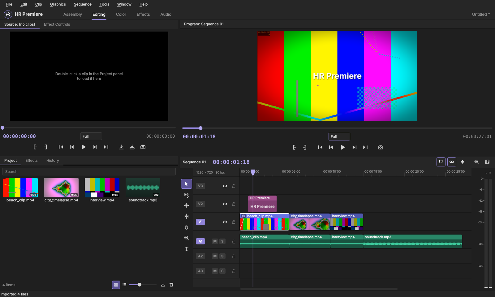

<p align="center">
  
</p>

<h1 align="center">HR Premiere</h1>

<p align="center">محرر فيديو لسطح المكتب مكتوب بلغة <b>C++</b> باستخدام <b>Qt 6</b> و<b>FFmpeg</b>، بنفس فكرة وتصميم Adobe Premiere Pro.</p>



## المميزات (الإصدار 0.1)

| | |
|---|---|
| **الواجهة** | نفس تقسيم بريمير: Source و Program و Project و Effect Controls و Effects و History و Timeline، مع شريط مساحات العمل (Assembly / Editing / Color / Effects / Audio) والألواح قابلة للسحب والتجميع. |
| **التايم لاين** | عدة مسارات فيديو وصوت، صور مصغّرة وموجات صوت على المقاطع، مسطرة Timecode، قفل/إخفاء/كتم/Solo للمسارات، تكبير وتصغير، Snap مغناطيسي. |
| **الأدوات** | Selection (V) · Track Select Forward (A) · Ripple Edit (B) · Razor (C) · Hand (H) · Zoom (Z) · Type (T). |
| **التحرير** | سحب وإفلات من لوحة المشروع، نقل المقاطع بين المسارات، تقليم الحواف، قص (Ctrl+K)، حذف عادي وحذف متتابع (Ripple)، نسخ/لصق، ربط الصوت بالصورة (Linked)، علامات (Markers) ونقطتي In/Out، Insert/Overwrite من Source، تراجع وإعادة غير محدودين تقريباً مع لوحة History. |
| **التأثيرات** | Motion (موقع/حجم/دوران) · Opacity مع Fade In/Out · Volume مع Fade · Balance · Brightness & Contrast · Color Correction · Black & White · Invert · Gaussian Blur · Sharpen · Mirror · Crop · Vignette · العناوين (Titles) بخط ولون وظل. |
| **التصدير** | H.264 · H.265 · ProRes · VP9 · GIF · MP3 · WAV بنفس محرك المعاينة (ما تشوفه هو ما يُصدَّر). |
| **المشاريع** | حفظ وفتح ملفات `.hrproj`، وإعادة ربط الملفات تلقائياً إذا نُقل المشروع. |
| **الأداء** | معاينة 1080p بـ ~3 ms للإطار، وتصدير أسرع من الزمن الحقيقي. فك الترميز والتركيب على خيط منفصل فالواجهة ما تتجمد. |


## التحميل (ويندوز)

كل مرة يُرفع تعديل على المشروع، يبني **GitHub Actions** البرنامج ويختبره ويجهّز نسخة ويندوز:

* **`HR-Premiere-Setup`** – برنامج تثبيت (`HR-Premiere-Setup.exe`)
* **`HR-Premiere-portable`** – نسخة محمولة: فك الضغط ثم شغّل `HRPremiere.exe`

من تبويب **Actions** في GitHub ← آخر تشغيل لـ *Build HR Premiere* ← قسم **Artifacts** في أسفل الصفحة.
(عند الدمج في الفرع الرئيسي تُنشر النسخة تلقائياً أيضاً في **Releases** باسم `hr-premiere-latest` كملفين جاهزين للتحميل المباشر.)

يتحقق الـCI على ويندوز من: البناء، كل الاختبارات، وتشغيل الحزمة على مسار نظيف (بدون أي برامج مثبّتة) مع تصدير تجريبي بالـ`ffmpeg.exe` المرفق.

> `ffmpeg.exe` مرفق داخل الحزمة ويُستخدم للتصدير. تفاصيل التراخيص في `NOTICE.txt` داخل الحزمة.

## البدء السريع

1. **File ▸ Import** (`Ctrl+I`) أو اسحب ملفات الفيديو/الصوت/الصور إلى لوحة **Project**.
2. اسحب مقطعاً إلى **Timeline**. أول مقطع يضبط إعدادات الـ Sequence (الأبعاد والـ fps) تلقائياً.
3. قصّ بـ `Ctrl+K` أو بأداة الشفرة `C`، رتّب المقاطع، وقلّم الحواف بالسحب.
4. اضغط على مقطع ثم عدّل **Effect Controls**، أو اسحب تأثيراً من لوحة **Effects** فوق المقطع.
5. `T` ثم اضغط على مسار فيديو لإضافة عنوان، وعدّل النص من Effect Controls.
6. **File ▸ Export Media** (`Ctrl+M`).

## الاختصارات

| المفتاح | الوظيفة | | المفتاح | الوظيفة |
|---|---|---|---|---|
| `Space` | تشغيل / إيقاف | | `Ctrl+K` | قص عند المؤشر |
| `←` `→` | إطار واحد | | `Ctrl+Shift+K` | قص كل المسارات |
| `Shift+←/→` | 5 إطارات | | `Delete` | حذف |
| `↑` `↓` | نقطة القص السابقة/التالية | | `Shift+Delete` | حذف متتابع (Ripple) |
| `Home` `End` | البداية / النهاية | | `Ctrl+Z` / `Ctrl+Shift+Z` | تراجع / إعادة |
| `V A B C H Z T` | الأدوات | | `Ctrl+C` `Ctrl+X` `Ctrl+V` | نسخ / قص / لصق |
| `I` `O` | نقطة بداية / نهاية | | `Ctrl+L` | ربط / فك ربط |
| `M` | علامة (Marker) | | `S` | تشغيل/إيقاف Snap |
| `+` `-` `\` | تكبير / تصغير / ملء | | `,` `.` | Insert / Overwrite من Source |

قائمة كاملة داخل البرنامج: **Help ▸ Keyboard Shortcuts**.

## ملاحظة عن الصوت والصورة

الصورة تمشي على ساعة سلسة وتتبع ساعة جهاز الصوت (أي تتعوّض تلقائياً زمن تأخير الجهاز). إذا الجهاز بطيء جداً (مثل بعض سماعات البلوتوث) يعيد البرنامج تشغيل الصوت مبكراً بمقدار التأخير المقاس. لو لاحظت فرقاً ثابتاً بسيطاً يمكن ضبطه بمتغير البيئة `HR_AUDIO_OFFSET_MS` (مثلاً `HR_AUDIO_OFFSET_MS=-60`).

## البناء من المصدر

المتطلبات: مترجم C++17 و CMake 3.21+ و **Qt 6.4+** (Widgets, Multimedia, Svg) و **FFmpeg 6+** (مكتبات التطوير) وأداة `ffmpeg` للتصدير.

**Ubuntu / Debian**

```bash
sudo apt install build-essential cmake ninja-build pkg-config ffmpeg \
  qt6-base-dev qt6-multimedia-dev qt6-svg-dev libgl1-mesa-dev \
  libavformat-dev libavcodec-dev libavutil-dev libswscale-dev libswresample-dev
cmake -S hr-premiere -B build -G Ninja -DCMAKE_BUILD_TYPE=Release
cmake --build build
./build/HRPremiere
```

**ويندوز (MSYS2 UCRT64)**: ثبّت `mingw-w64-ucrt-x86_64-{toolchain,cmake,ninja,pkgconf,qt6-base,qt6-multimedia,qt6-svg,qt6-tools,ffmpeg}` ثم نفس أوامر CMake، والتحزيم بـ `scripts/package_windows.sh` (راجع `.github/workflows/build-hr-premiere.yml`).

## الاختبارات

```bash
QT_QPA_PLATFORM=offscreen ctest --test-dir build --output-on-failure
```

* `hr_tests` (21): عمليات التحرير، الحفظ والتراجع، فك ترميز الفيديو/الصوت، التركيب والتأثيرات، مزج الصوت، وتصدير MP4/WAV حقيقي مع فحص الألوان والصوت.
* `hr_ui_tests` (21): تشغيل النافذة الحقيقية وتحريك الماوس والكيبورد: سحب المقاطع، التقليم، الشفرة، الحذف، التراجع، التشغيل، الإفلات من لوحة المشروع، مراقب Source (In/Out، Insert/Overwrite)، قفل المسارات، العناوين، التأثيرات.

## هيكل المشروع

```
src/core     الموديل (Timeline/Clip/Track)، التأثيرات، عمليات التحرير، المشروع وUndo
src/media    فك الترميز بـ FFmpeg: فيديو، صوت، فحص الملفات، الصور المصغّرة وموجات الصوت
src/engine   المركِّب (Renderer)، خلاط الصوت، المشغّل (Player)، الإخراج الصوتي، التصدير
src/ui       النافذة الرئيسية والألواح والتايم لاين والحوارات والثيم والأيقونات
tests        اختبارات المحرك والواجهة
installer    سكربت Inno Setup لبرنامج التثبيت
```

## غير موجود بعد (خارطة الطريق)

Keyframes · الانتقالات بين المقاطع (Dissolve…) · تغيير السرعة · Nested sequences · Proxy للملفات الكبيرة · تسريع GPU · نسخة macOS · واجهة بالعربية · ترجمة تلقائية بالذكاء الاصطناعي (Python).

## ترخيص

الكود جزء من هذا المستودع. حزمة ويندوز تضم **FFmpeg** (مع libx264) المرخّص **GPL**، و**Qt** المرخّص LGPL.
اسم وهوية "HR Premiere" مستقلان وغير تابعين لشركة Adobe.
